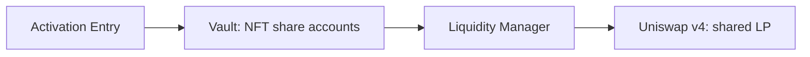

# ZZZ Collection - Proof of Permanent Liquidity (PoPL)

PoPL connects transferable NFTs to vault-managed liquidity. Activating an NFT attaches an LP allocation and unlocks two income streams: funded LP revenue and a separate share of NFT-sale royalties.

**Status: undeployed contract candidate; not approved for real funds.** The [website demo](https://popldemo.0xwave.com) uses simulated balances and transactions.

**Current development work (2026-10-18):** governance operations and approved LP migrations now have no mandatory waiting period. Authorization, sealing, execution-loss limits and custody checks remain. See [immediate governance](docs/GOVERNANCE.md), [scoped verification](reports/immediate-governance/VERIFICATION.md) and the [resume handoff](docs/WORK_HANDOFF.md). Release remains NOT APPROVED.

## Project navigation

| Purpose | Start here |
| --- | --- |
| Progress and remaining work | **[Project Todo](TODO.md)** - the single task list, with expandable acceptance criteria |
| What is built and tested | [Feature and evidence reference](docs/IMPLEMENTATION_STATUS.md) - capabilities, boundaries and verification |
| Manage the protocol | **[Operator manual](docs/OPERATOR_MANUAL.md)** - exact controls, range/assets/pools, emergency stops and restart procedures |
| System design | [Architecture](docs/ARCHITECTURE.md) for interactions; [evolution and trust boundaries](docs/ARCHITECTURE_EVOLUTION.md) for migration limits; [Component map](docs/COMPONENT_STATUS.md) for each module's responsibilities |
| Security and release | [Security audit plan](docs/SECURITY_AUDIT_PLAN.md) for review criteria; [Release approval record](docs/RELEASE_CHECKLIST.md) for the final go/no-go decision |

## Architecture overview

| Layer | Owns this responsibility | Explore |
| --- | --- | --- |
| **1. Smart contracts** | Enforce ownership, LP custody, accounting and permissions on-chain. | [Contract components](#contract-components) |
| **2. Backend and operations** | Read confirmed state, prepare unsigned user transactions and operate authorized maintenance. | [Services and data flow](#backend-components) |
| **3. Frontend** | Explain the product and present NFT positions and wallet actions. Currently a simulation. | [Website components](#frontend-components) |

<a id="contract-components"></a>

### 1. Smart contracts

The main activation path separates contribution routing, share accounting and venue execution:



| Component group | Responsibility and relationship | Source / design |
| --- | --- | --- |
| **NFT identity and artwork** | Records the current owner and immutable revealed traits. Metadata reads the NFT's current attached LP value to select its evolution. | [NFT](src/ZZZNFT.sol), [metadata](src/ZZZNFTMetadata.sol), [trait/reveal design](docs/NFT_METADATA.md) |
| **Activation and admission** | Entry authenticates the owner, checks admitted assets/routes, converts the contribution and binds its original value to the exact Vault call. The registry defines approved pools and policies. | [Entry](src/ZZZActivationEntry.sol), [asset policies](src/ZZZActivationAssets.sol), [pool registry](src/ZZZPoolRegistry.sol) |
| **Custody and per-NFT shares** | Vault owns the physical LP and records each NFT's nonredeemable shares. LiquidityManager executes typed venue operations; the budget helper checks contribution and maintenance loss limits. | [Vault](src/ZZZVault.sol), [LiquidityManager](src/ZZZLiquidityManager.sol), [budget helper](src/ZZZMigrationBudget.sol) |
| **LP revenue accounting** | Creator inboxes and venue collections feed FeeController. It allocates receipts to holder/collective balances and separate compound/buyback reserves. Membership gives each activated NFT one collective share. | [FeeController](src/ZZZFeeController.sol), [Rewards](src/ZZZRewards.sol), [Membership](src/ZZZMembership.sol), [creator intake](docs/EXTERNAL_REWARDS.md) |
| **Royalties and claims** | RoyaltyRewards preserves per-NFT entitlements, isolates optional currency outages and credits batch-converted ETH to the same NFTs. Current owners claim through either ledger or ClaimRouter. | [RoyaltyRewards](src/ZZZRoyaltyRewards.sol), [converter](src/ZZZRoyaltyConverter.sol), [ClaimRouter](src/ZZZClaimRouter.sol), [operator flow](docs/ROYALTY_SETTLEMENT.md) |
| **Valuation and maintenance** | Oracle supplies guarded values; Strategy defines ranges and eligibility. Keeper calls execute through Vault, Compounder or Buyback within on-chain limits. | [Oracle](src/ZZZOracle.sol), [Strategy](src/ZZZStrategy.sol), [Compounder](src/ZZZCompounder.sol), [Buyback](src/ZZZBuyback.sol) |
| **Governance and permissions** | AccessController binds modules and enforces immediate authorized configuration, guardian pause and keeper authorization. Sealing fixes module bindings; constrained configuration remains available. | [AccessController](src/ZZZAccessController.sol), [authority and change boundaries](docs/CHANGE_AND_RECOVERY.md) |
| **Recovery and migration** | Migration coordinates approved LP parking/moves. A separate canonical handoff coordinates ownership, ledgers and backing when replacing a whole deployment. Future-chain completion remains open. | [Migration](src/ZZZMigration.sol), [CanonicalHandoff](src/ZZZCanonicalHandoff.sol), [handoff scope](docs/CANONICAL_HANDOFF.md) |

Many NFTs share **one physical LP per pool/strategy**, with independent share accounts. Maintenance operates on the shared position. The initial collection is intended to use one pool; the Vault allows four permanently admitted/historical custody buckets, including reservations and imports. An existing bucket's migration or return reuses its slot. See the [detailed interactions](docs/ARCHITECTURE.md) and [complete module/helper map](docs/COMPONENT_STATUS.md).

<a id="backend-components"></a>

### 2. Backend and operations

Read services serve confirmed chain state. Transaction preparation returns an unsigned request for the user's wallet. The keeper uses a separate operator signer for authorized maintenance; it does not sign user activations.

| Service | Responsibility and relationship | Code / operating reference |
| --- | --- | --- |
| **Event indexer** | Reads confirmed contract logs into SQLite, detects bounded reorgs and supplies replay history for ownership and claims. | [Indexer](indexer/monitor.py), [event schema](indexer/event_schema.json), [history requirements](docs/FRONTEND_HISTORY.md) |
| **Read API** | Verifies deployment/lifecycle at a confirmed block, then reads current owners, LP values and funded balances. Optional current-ledger reporting separates ETH/source balances and deferred royalty eligibility; complete pinned predecessor replay carries lifetime claims and conversion credits across same-chain handoffs. | [Service](frontend_api/service.py), [lifecycle](frontend_api/lifecycle.py), [lineage replay](frontend_api/lineage.py), [API contract](docs/FRONTEND_API.md), [royalty reporting](docs/ROYALTY_REPORTING.md) |
| **Earnings history** | Replays actual processed LP/royalty earnings per collection and NFT, preserving weights, fractions and complete same-chain lineage. Optional reviewed prices value original earned currencies at today's confirmed snapshot. Claims, conversions and current balances stay separate. | [Replay/API](frontend_api/earnings.py), [configuration and operations](docs/EARNINGS_HISTORY.md), [evidence](reports/earnings-history/VERIFICATION.md) |
| **Activation preparation** | Checks asset/route/feed bindings, simulates the complete Entry call, measures new LP, and returns exact unsigned calldata and separate gas. Missing approval produces an approval step before re-quoting. | [Preparation](frontend_api/activation.py), [opt-in endpoint](frontend_api/activation_server.py), [integration sequence](docs/ACTIVATION_PREPARATION.md) |
| **Keeper** | Discovers shared buckets, checks eligibility, simulates and submits authorized upkeep. Persists intents, receipts and budgets for recovery; optional metadata watching uses the same bounded transaction path. | [Monitor](keeper/monitor.py), [execution](keeper/ops.py), [recovery runbook](docs/KEEPER_RECOVERY.md) |
| **Revenue measurement** | Calculates proposed active-liquidity shares for creator-payment reconciliation. Measurements do not collect money or create claimable rewards. | [Measurement tool](zzz_ops/revenue_share.py), [agreement and calculation model](docs/REVENUE_SHARE.md) |

These services require qualified RPC/archive providers, feeds, configuration and operating procedures. Hosting and live integration remain open. The API does not hold user keys; the contracts still enforce transaction permissions and accounting.

<a id="frontend-components"></a>

### 3. Frontend

The website is maintained in [AAA-website](https://github.com/ABEF/AAA-website). Its current components are:

| Component | Current responsibility | Website source |
| --- | --- | --- |
| **Pages and interactions** | Navigation, collection/portfolio cards, dialogs, contribution and claim interfaces. | [app.js](https://github.com/ABEF/AAA-website/blob/main/app.js) |
| **Demo data and accounting** | Example NFTs, balances, contribution events and simulated claims. This model must be replaced by confirmed API data for live use. | [domain.js](https://github.com/ABEF/AAA-website/blob/main/domain.js) |
| **Wallet connection** | Connects a browser wallet and handles account/chain changes. Live transaction validation, signing requests and receipt handling remain to be integrated. | [wallet.js](https://github.com/ABEF/AAA-website/blob/main/wallet.js) |
| **Artwork catalogue** | Resolves palette, pattern, rarity and evolution assets for display. On-chain metadata remains authoritative for a real NFT. | [artworks.js](https://github.com/ABEF/AAA-website/blob/main/artworks.js), [palette-system.js](https://github.com/ABEF/AAA-website/blob/main/palette-system.js) |

The target live flow is **website -> read/preparation API -> user wallet confirmation -> contracts -> confirmed receipt/indexer/API refresh**. The current website still simulates minting, LP contributions and claims; see the [frontend integration tasks](TODO.md#frontend).

## NFT lifecycle

| Step | Rule |
| --- | --- |
| **Mint** | Pay exactly **0.05 ETH** to the immutable mint recipient for a dormant NFT. Minting adds supply, not liquidity or reward eligibility. |
| **Activate** | After traits are revealed, contribute at least **$100 in original gross input value**. At least **99% must become new LP**; conversion costs, slippage and undeployed input share one 1% limit. Network gas is separate. |
| **Add liquidity** | Further contributions grow the same NFT's LP allocation under the same execution limit. Existing holders' assets cannot subsidize that limit; a top-up creates no extra collective membership. |
| **Hold or transfer** | The current owner can claim its funded balances. Transfers carry the LP allocation, remaining unclaimed balances and future fee rights. A seller can claim before a transfer, so an earlier listing balance is not guaranteed to the buyer. |

**LP principal cannot be redeemed by holders.** It remains managed by the protocol for rebalancing, compounding and approved migration. A right to future funded fees has no expiry, but does not guarantee future revenue or capital value.

Target activation assets are **ETH, ZZZ, USDG and USDC**, admitted by reviewed address and route. Actual routes and feeds still require qualification; USDC has no qualified funded route. The [atomic Entry](docs/ACTIVATION_ENTRY.md) binds the original contribution value through conversion into LP; [route qualification](docs/ACTIVATION_ROUTING.md) covers the remaining integration work.

## Revenue and claims

### LP and creator revenue

The allocation is fixed in the current contracts:

| Use | Share | Basis |
| --- | --- | --- |
| Individual NFT holders | **80%** | Proportional to each NFT's shares in the earning LP bucket |
| Collective rewards | **10%** | Equal per activated NFT, across pools |
| LP compounding | **5%** | Reserved for reinvestment in the earning bucket |
| ZZZ buyback and burn | **5%** | Reserved for approved execution |

Rarity does not change LP or collective weights; there is no Power multiplier. Actual receipts allocate in batches of 20 raw token units, with a documented sub-20-unit incumbent-dust exception at membership/migration boundaries. Returned remote holder rewards are already allocated and are not split again. See [accounting and timing](docs/ECONOMICS.md).

The selected Robinhood ZZZ/native-ETH Pons pool has **0% conventional LP fees**. Creator/hook revenue is a separate funding path: the reported proportional-liquidity agreement still needs final payment and measurement terms. Adding LP does not by itself fund claims. See [current market qualification](TODO.md#task-pons-qualification) and [creator revenue-sharing proposals](docs/REVENUE_SHARE.md).

### NFT-sale royalties

ERC-2981 requests **5% of sale value** to the immutable royalty receiver. **100% of eligible receipts** are shared among activated NFTs at **Commun x1 / Rare x2 / Legendary x3**, independently of LP shares. Prefunds, pre-admission receipts and payments with no eligible members stay quarantined. ERC-2981 does not enforce marketplace payment. The optional keeper converts earned WETH/stablecoin royalties into ETH in guarded batches, preserving each NFT's share; the 1% execution-loss cap excludes gas. Failed optional currencies defer only their new eligibility, with earlier royalties protected. See the [settlement runbook](docs/ROYALTY_SETTLEMENT.md) and [separate royalty ledger](docs/NFT_METADATA.md#separate-marketplace-royalties).

Claims follow funding events, not a per-minute clock. LP claims use allocated balances; royalty claims also synchronize pending admitted receipts. Direct claims take one NFT and asset; the [claim router](docs/CLAIM_ROUTER.md) supports up to **32 mixed LP/royalty operations**, paid to the current owner. [Timing and keeper schedules](docs/OPERATIONS.md#reward-timing-and-maintenance-schedule) explain when processing occurs.

## Collection and artwork

- **Supply:** at most **1,000 NFTs**, with exact eventual quotas of **600 Commun / 300 Rare / 100 Legendary**.
- **Assignment:** an authenticated random draw selects fixed inventory entries without replacement, finalized in mint order. There is no administrator trait selection or reroll. A stalled earlier request can block later reveals; live VRF qualification remains open.
- **Fixed traits:** rarity, palette and pattern never change. Eight colors form 58 palettes across monochrome, bicolor and tricolor styles; four patterns produce **2,784 rendered evolution states**. Palette and pattern do not change rewards; rarity affects only royalty weight.
- **Evolution:** Dormant until activation; afterward, current marked LP value selects Activated, **Enhanced from $1,000**, or **Singularity from $10,000**. Falling value can downgrade art without removing activation or fee rights. Remote or stale valuation is explicitly unavailable.

The [metadata specification](docs/NFT_METADATA.md) and [artwork catalogue](design/nft-metadata/palette-system-v1/README.md) detail inventory quotas, duplicate limits, palettes and patterns. The [IPFS bundle](docs/ARTWORK_PUBLICATION.md) is prepared; provider selection, publication and marketplace refresh testing remain open.

## Governance, custody and recovery

### Authority and configuration

| Role | Authority | Boundary |
| --- | --- | --- |
| **Governance multisig** | Approves configuration and supported recovery operations through the zero-delay governance controller. | Approved modules, destinations and replacement code require security review; governance remains a trust dependency. |
| **Guardian** | Pauses operations during an incident. | Cannot unpause or withdraw principal; unpause belongs to governance. |
| **Keeper** | Executes eligible maintenance within contract permissions and economic limits. | Cannot change governance policy or bypass execution guards. |

Production addresses are not selected. The [address inventory](docs/DEPLOYMENT_ADDRESSES.md) separates authority wallets, deployed contracts and network dependencies.

**Sealing fixes module implementations and local venue bindings.** Governance can still configure supported assets, routes, feeds, destinations and strategy parameters within existing controls. New algorithms or unsupported venues need separately reviewed compatible deployments, rather than an in-place code update. The [change and recovery matrix](docs/CHANGE_AND_RECOVERY.md) details these boundaries.

The [operator manual](docs/OPERATOR_MANUAL.md#stop-controls) includes a governed
mint-only pause and disable-only pool controls that work without healthy pool
dependencies. Re-enabling a pool still requires full validation; existing rights
retain their independent guards. See [scoped verification](reports/operator-controls/VERIFICATION.md).

### Recovery paths

| Situation | Supported path and limits | Reference |
| --- | --- | --- |
| **Pause and park LP** | Governance can close LP into Vault custody while globally paused, using an exact snapshot and raw output minimums. Parking omits source-price reads and creator-inbox synchronization; resume requires fresh valuation and execution guards. Failed tokens or venues can still prevent movement. | [Custody parking](docs/CUSTODY_PARKING.md) |
| **Move LP between local pools** | Approved moves preserve the bucket's NFT shares and liabilities. Current moves require the same ordered accounting currencies; different-pair conversion remains unfinished. Moving LP alone does not relocate NFT ownership or reward ledgers. | [Migration safety](docs/MIGRATION_SAFETY.md) |
| **Review replacement NFT holders** | A confirmed owner/code inventory identifies contracts and delegated accounts requiring escrow release/claim review; rescan after freeze. Complete inventory is not migration approval. | [Holder preflight](docs/HOLDER_PREFLIGHT.md) |
| **Replace the whole deployment on the same chain** | The handoff candidate freezes and carries NFT ownership, both reward ledgers and exact classified backing to one replacement. Retirement/activation is atomic, with a restored funded abort path before retirement. Reviewed replacement code is an accepted governance trust boundary. | [Canonical handoff](docs/CANONICAL_HANDOFF.md) |
| **Relocate the collection to another chain** | Verified source finality, authenticated channel closure, new lineage/message semantics and reviewed transport remain pre-seal work. There is no multisig-only activation override. Recovery after a permanent source-chain halt is deferred. | [Canonical migration design](docs/CANONICAL_MIGRATION_DESIGN.md) |

**Real bridging remains disabled** pending independent destination-admission review, provider/backing review and multi-chain rehearsals. Local permanent capacity reservation is implemented; the source does not authenticate remote admission proof. The [security audit plan](docs/SECURITY_AUDIT_PLAN.md) covers these cross-contract and external-dependency risks.

## Keeper and operating services

The keeper **defaults to dry run**. Full keeper/state-lock operation requires **Linux/Unix and Python 3.11+**.

- **Polling:** the example checks every ten minutes; this is not a guaranteed execution schedule.
- **Rebalancing:** price movement or an approved range change must make the position eligible. Cooldown, fresh prices and execution guards still apply. See [range-policy behavior](docs/RANGE_POLICY_UPDATES.md).
- **Metadata:** the optional watcher is disabled by default and uses the same bounded transaction path.

| Operating task | Start here |
| --- | --- |
| Select RPC, pricing, randomness and other dependencies | [Production service decisions](docs/PRODUCTION_SERVICES.md) |
| Configure and run maintenance | [Operations guide](docs/OPERATIONS.md) |
| Recover after an outage, lost state or server loss | [Recovery runbook](docs/KEEPER_RECOVERY.md) |
| Rehearse failures and assess operating evidence | [Keeper rehearsals](docs/KEEPER_REHEARSALS.md) |
| Assess remaining security and availability risks | [Internal keeper review](reports/keeper-recovery/REVIEW.md) |

## Verification and release status

**Release decision: NOT APPROVED.** Local verification, published CI and independent release approval are separate requirements. Each report applies only to its recorded source, configuration and test scope; no full current-source regression is claimed by combining historical counts.

### Find the relevant evidence

| Area | Evidence | Scope |
| --- | --- | --- |
| **LP accounting and maintenance** | [Dynamic liquidity](reports/dynamic-liquidity/VERIFICATION.md), [range-policy updates](reports/range-policy/VERIFICATION.md) | Contribution/valuation guards, aggregate rebalance budget, range-change eligibility and targeted venue/backend checks. |
| **Backend integration** | [Activation preparation](reports/activation-preparation/VERIFICATION.md), [API lifecycle](reports/frontend-lifecycle/VERIFICATION.md), [claim-history lineage](reports/frontend-lineage/VERIFICATION.md) | Scoped transaction preparation and confirmed reads; not hosted-service or live website qualification. |
| **Same-chain replacement** | [Canonical handoff](reports/canonical-handoff/VERIFICATION.md) | Handoff accounting and regression evidence for its recorded snapshot. Later changed paths use the separate reports above. |
| **Local $1 test build** | [Rehearsal verification](reports/one-dollar-rehearsal/VERIFICATION.md) | Separate generated copy with mock services; not the production binary or live Pons execution. |
| **Published revision** | [GitHub Actions](https://github.com/ABEF/AAA/actions) | Check the exact commit and required jobs. Local results do not establish a green published workflow. |

<details>
<summary>Earlier verification and review history</summary>

- [NFT economic-rights verification](reports/nft-rights-audit/VERIFICATION.md): its historical 531 Solidity passes, two expected fork skips, 23 size gates and 65,536-call invariant run retain their original scope. The accompanying [internal review](reports/nft-rights-audit/REVIEW.md) records findings and risks.
- [Architecture evolution](reports/architecture-evolution/VERIFICATION.md) and [migration safety](reports/migration-safety/VERIFICATION.md): earlier source-specific evidence; neither verifies later handoff or maintenance changes.
- [Report index](reports/README.md): remaining historical receipts and their context.

</details>

### Production approval

Remaining work is tracked only in the [Project Todo](TODO.md). It includes:

- **Dependencies and configuration:** qualified market/input routes, tokens, feeds and VRF; authority addresses and creator-payment terms.
- **Integration and operations:** live frontend/backend flows, target-chain gas/strategy qualification and operating rehearsals.
- **Independent assurance:** external audit, remediation and final configuration/release review.

The [production inventory](config/production.example.json) records the exact deployment configuration and evidence. The [release approval record](docs/RELEASE_CHECKLIST.md) records the final go/no-go decision. Internal reviews and local passes do not replace either.

## Development

### Setup and verification

Use the [supported development environment](docs/DEVELOPMENT.md), including Linux/Unix or WSL for complete off-chain verification. From the repository root:

```sh
# Install pinned dependencies when setting up the checkout.
bash scripts/install-deps.sh

# Run full verification when the change or release requires it.
bash scripts/verify.sh
```

The verifier runs Python/source checks, normal build/size checks and offline Solidity tests. The toolchain uses **Solidity 0.8.26, Cancun and the configured via-IR optimizer profile**. During iteration, run checks for the affected behavior and reuse unchanged source-bound evidence. The development guide provides explicit fork and static-analysis commands. These commands do not deploy public contracts.

### Small-value experiments

The [local $1 activation rehearsal](docs/ONE_DOLLAR_REHEARSAL.md) generates an isolated test build. It retains the **1% execution-loss limit** and **0.05 ETH mint price**; production activation remains **$100**. It does not enable live wallet transactions.

### Keep project records consistent

When implementation or evidence changes, follow the [Todo maintenance procedure](docs/TODO_WORKFLOW.md): update the [task ledger](docs/project-todo.json), reconcile the [feature/evidence reference](docs/IMPLEMENTATION_STATUS.md), then regenerate and check the task list:

```sh
python3 scripts/sync-project-todo.py
python3 scripts/sync-project-todo.py --check
```

Keep local work, GitHub publication, test evidence and deployment status explicit. The central Todo owns task status; feature references and release records have their separate purposes.
