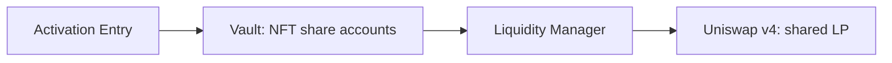

# ZZZ Collection - Proof of Permanent Liquidity (PoPL)

PoPL connects transferable NFTs to vault-managed liquidity. Activating an NFT attaches an LP allocation and unlocks two income streams: funded LP revenue and a separate share of NFT-sale royalties.

**Status: undeployed contract candidate; not approved for real funds.** The [website demo](https://popldemo.0xwave.com) uses simulated balances and transactions.

**Current development work (2026-10-18):** timelocked range changes can now make the existing keeper rebalance eligible at a flat price, with cooldown, price/minimum-output guards and the 3% aggregate cap retained. See [range policy](docs/RANGE_POLICY_UPDATES.md), [scoped verification](reports/range-policy/VERIFICATION.md), [dynamic accounting](docs/DYNAMIC_LIQUIDITY.md) and the [resume handoff](docs/WORK_HANDOFF.md). Earlier regression receipts retain their own source scope; release remains NOT APPROVED.

## Project navigation

| Purpose | Start here |
| --- | --- |
| Progress and remaining work | **[Project Todo](TODO.md)** - the single task list, with expandable acceptance criteria |
| What is built and tested | [Feature and evidence reference](docs/IMPLEMENTATION_STATUS.md) - capabilities, boundaries and verification |
| System design | [Architecture](docs/ARCHITECTURE.md) for interactions; [evolution and trust boundaries](docs/ARCHITECTURE_EVOLUTION.md) for migration limits; [Component map](docs/COMPONENT_STATUS.md) for each module's responsibilities |
| Security and release | [Security audit plan](docs/SECURITY_AUDIT_PLAN.md) for review criteria; [Release approval record](docs/RELEASE_CHECKLIST.md) for the final go/no-go decision |

## Architecture overview

| Layer | Owns this responsibility | Explore |
| --- | --- | --- |
| **1. Smart contracts** | Enforce ownership, LP custody, accounting and permissions on-chain. | [Contract components](#contract-components) |
| **2. Backend and operations** | Read confirmed state, prepare unsigned user transactions and operate authorized maintenance. | [Services and data flow](#backend-components) |
| **3. Frontend** | Explain the product and present NFT positions and wallet actions. Currently a simulation. | [Website components](#frontend-components) |

<a id="contract-components"></a>

### 1. Smart contracts

The main activation path separates contribution routing, share accounting and venue execution:



| Component group | Responsibility and relationship | Source / design |
| --- | --- | --- |
| **NFT identity and artwork** | Records the current owner and immutable revealed traits. Metadata reads the NFT's current attached LP value to select its evolution. | [NFT](src/ZZZNFT.sol), [metadata](src/ZZZNFTMetadata.sol), [trait/reveal design](docs/NFT_METADATA.md) |
| **Activation and admission** | Entry authenticates the owner, checks admitted assets/routes, converts the contribution and binds its original value to the exact Vault call. The registry defines approved pools and policies. | [Entry](src/ZZZActivationEntry.sol), [asset policies](src/ZZZActivationAssets.sol), [pool registry](src/ZZZPoolRegistry.sol) |
| **Custody and per-NFT shares** | Vault owns the physical LP and records each NFT's nonredeemable shares. LiquidityManager executes typed venue operations; the budget helper checks contribution and maintenance loss limits. | [Vault](src/ZZZVault.sol), [LiquidityManager](src/ZZZLiquidityManager.sol), [budget helper](src/ZZZMigrationBudget.sol) |
| **LP revenue accounting** | Creator inboxes and venue collections feed FeeController. It allocates receipts to holder/collective balances and separate compound/buyback reserves. Membership gives each activated NFT one collective share. | [FeeController](src/ZZZFeeController.sol), [Rewards](src/ZZZRewards.sol), [Membership](src/ZZZMembership.sol), [creator intake](docs/EXTERNAL_REWARDS.md) |
| **Royalties and claims** | RoyaltyRewards accounts for received marketplace royalties separately. Current owners claim through either ledger or the bounded ClaimRouter; unclaimed balances follow the NFT. | [RoyaltyRewards](src/ZZZRoyaltyRewards.sol), [ClaimRouter](src/ZZZClaimRouter.sol), [claim flow](docs/CLAIM_ROUTER.md) |
| **Valuation and maintenance** | Oracle supplies guarded values; Strategy defines ranges and eligibility. Keeper calls execute through Vault, Compounder or Buyback within on-chain limits. | [Oracle](src/ZZZOracle.sol), [Strategy](src/ZZZStrategy.sol), [Compounder](src/ZZZCompounder.sol), [Buyback](src/ZZZBuyback.sol) |
| **Governance and permissions** | AccessController binds modules and enforces timelocked configuration, guardian pause and keeper authorization. Sealing fixes module bindings; constrained configuration remains available. | [AccessController](src/ZZZAccessController.sol), [authority and change boundaries](docs/CHANGE_AND_RECOVERY.md) |
| **Recovery and migration** | Migration coordinates approved LP parking/moves. A separate canonical handoff coordinates ownership, ledgers and backing when replacing a whole deployment. Future-chain completion remains open. | [Migration](src/ZZZMigration.sol), [CanonicalHandoff](src/ZZZCanonicalHandoff.sol), [handoff scope](docs/CANONICAL_HANDOFF.md) |

Many NFTs share **one physical LP per pool/strategy**, with independent share accounts. Maintenance operates on the shared position. The initial collection is intended to use one pool; the Vault allows four permanently admitted/historical custody buckets, including reservations and imports. An existing bucket's migration or return reuses its slot. See the [detailed interactions](docs/ARCHITECTURE.md) and [complete module/helper map](docs/COMPONENT_STATUS.md).

<a id="backend-components"></a>

### 2. Backend and operations

Read services serve confirmed chain state. Transaction preparation returns an unsigned request for the user's wallet. The keeper uses a separate operator signer for authorized maintenance; it does not sign user activations.

| Service | Responsibility and relationship | Code / operating reference |
| --- | --- | --- |
| **Event indexer** | Reads confirmed contract logs into SQLite, detects bounded reorgs and supplies replay history for ownership and claims. | [Indexer](indexer/monitor.py), [event schema](indexer/event_schema.json), [history requirements](docs/FRONTEND_HISTORY.md) |
| **Read API** | Verifies deployment/lifecycle at a confirmed block, then reads current owners, LP values and funded balances. Optional pinned predecessor replay combines lifetime LP/royalty claims across same-chain handoffs. | [Service](frontend_api/service.py), [lifecycle](frontend_api/lifecycle.py), [lineage replay](frontend_api/lineage.py), [API contract](docs/FRONTEND_API.md) |
| **Activation preparation** | Checks asset/route/feed bindings, simulates the complete Entry call, measures new LP, and returns exact unsigned calldata and separate gas. Missing approval produces an approval step before re-quoting. | [Preparation](frontend_api/activation.py), [opt-in endpoint](frontend_api/activation_server.py), [integration sequence](docs/ACTIVATION_PREPARATION.md) |
| **Keeper** | Discovers shared buckets, checks eligibility, simulates and submits authorized upkeep. Persists intents, receipts and budgets for recovery; optional metadata watching uses the same bounded transaction path. | [Monitor](keeper/monitor.py), [execution](keeper/ops.py), [recovery runbook](docs/KEEPER_RECOVERY.md) |
| **Revenue measurement** | Calculates proposed active-liquidity shares for creator-payment reconciliation. Measurements do not collect money or create claimable rewards. | [Measurement tool](zzz_ops/revenue_share.py), [agreement and calculation model](docs/REVENUE_SHARE.md) |

These services require qualified RPC/archive providers, feeds, configuration and operating procedures. Hosting and live integration remain open. The API does not hold user keys; the contracts still enforce transaction permissions and accounting.

<a id="frontend-components"></a>

### 3. Frontend

The website is maintained in [AAA-website](https://github.com/ABEF/AAA-website). Its current components are:

| Component | Current responsibility | Website source |
| --- | --- | --- |
| **Pages and interactions** | Navigation, collection/portfolio cards, dialogs, contribution and claim interfaces. | [app.js](https://github.com/ABEF/AAA-website/blob/main/app.js) |
| **Demo data and accounting** | Example NFTs, balances, contribution events and simulated claims. This model must be replaced by confirmed API data for live use. | [domain.js](https://github.com/ABEF/AAA-website/blob/main/domain.js) |
| **Wallet connection** | Connects a browser wallet and handles account/chain changes. Live transaction validation, signing requests and receipt handling remain to be integrated. | [wallet.js](https://github.com/ABEF/AAA-website/blob/main/wallet.js) |
| **Artwork catalogue** | Resolves palette, pattern, rarity and evolution assets for display. On-chain metadata remains authoritative for a real NFT. | [artworks.js](https://github.com/ABEF/AAA-website/blob/main/artworks.js), [palette-system.js](https://github.com/ABEF/AAA-website/blob/main/palette-system.js) |

The target live flow is **website -> read/preparation API -> user wallet confirmation -> contracts -> confirmed receipt/indexer/API refresh**. The current website still simulates minting, LP contributions and claims; see the [frontend integration tasks](TODO.md#frontend).

## NFT lifecycle

| Step | Rule |
| --- | --- |
| **Mint** | Pay exactly **0.05 ETH** to the immutable mint recipient for a dormant NFT. Minting adds supply, not liquidity or reward eligibility. |
| **Activate** | After traits are revealed, contribute at least **$100 in original gross input value**. At least **99% must become new LP**; conversion costs, slippage and undeployed input share one 1% limit. Network gas is separate. |
| **Add liquidity** | Further contributions grow the same NFT's LP allocation under the same execution limit. Existing holders' assets cannot subsidize that limit; a top-up creates no extra collective membership. |
| **Hold or transfer** | The current owner can claim its funded balances. Transfers carry the LP allocation, remaining unclaimed balances and future fee rights. A seller can claim before a transfer, so an earlier listing balance is not guaranteed to the buyer. |

**LP principal cannot be redeemed by holders.** It remains managed by the protocol for rebalancing, compounding and approved migration. A right to future funded fees has no expiry, but does not guarantee future revenue or capital value.

Target activation assets are **ETH, ZZZ, USDG and USDC**, admitted by reviewed address and route. Actual routes and feeds still require qualification; USDC has no qualified funded route. The [atomic Entry](docs/ACTIVATION_ENTRY.md) binds the original contribution value through conversion into LP; [route qualification](docs/ACTIVATION_ROUTING.md) covers the remaining integration work.

## Revenue and claims

### LP and creator revenue

The allocation is fixed in the current contracts:

| Use | Share | Basis |
| --- | --- | --- |
| Individual NFT holders | **80%** | Proportional to each NFT's shares in the earning LP bucket |
| Collective rewards | **10%** | Equal per activated NFT, across pools |
| LP compounding | **5%** | Reserved for reinvestment in the earning bucket |
| ZZZ buyback and burn | **5%** | Reserved for approved execution |

Rarity does not change LP or collective weights; there is no Power multiplier. Actual receipts allocate in batches of 20 raw token units, with a documented sub-20-unit incumbent-dust exception at membership/migration boundaries. Returned remote holder rewards are already allocated and are not split again. See [accounting and timing](docs/ECONOMICS.md).

The selected Robinhood ZZZ/native-ETH Pons pool has **0% conventional LP fees**. Creator/hook revenue is a separate funding path: the reported proportional-liquidity agreement still needs final payment and measurement terms. Adding LP does not by itself fund claims. See [current market qualification](TODO.md#task-pons-qualification) and [creator revenue-sharing proposals](docs/REVENUE_SHARE.md).

### NFT-sale royalties

ERC-2981 requests **5% of sale value** to the immutable royalty receiver. **100% of eligible receipts** are shared among activated NFTs at **Commun x1 / Rare x2 / Legendary x3**, independently of LP shares. Prefunds, pre-admission receipts and payments with no eligible members stay quarantined. ERC-2981 does not enforce marketplace payment. See the [separate royalty ledger](docs/NFT_METADATA.md#separate-marketplace-royalties).

Claims follow funding events, not a per-minute clock. LP claims use allocated balances; royalty claims also synchronize pending admitted receipts. Direct claims take one NFT and asset; the [claim router](docs/CLAIM_ROUTER.md) supports up to **32 mixed LP/royalty operations**, paid to the current owner. [Timing and keeper schedules](docs/OPERATIONS.md#reward-timing-and-maintenance-schedule) explain when processing occurs.

## Collection and artwork

- **Supply:** at most **1,000 NFTs**, with exact eventual quotas of **600 Commun / 300 Rare / 100 Legendary**.
- **Assignment:** an authenticated random draw selects fixed inventory entries without replacement, finalized in mint order. There is no administrator trait selection or reroll. A stalled earlier request can block later reveals; live VRF qualification remains open.
- **Fixed traits:** rarity, palette and pattern never change. Eight colors form 58 palettes across monochrome, bicolor and tricolor styles; four patterns produce **2,784 rendered evolution states**. Palette and pattern do not change rewards; rarity affects only royalty weight.
- **Evolution:** Dormant until activation; afterward, current marked LP value selects Activated, **Enhanced from $1,000**, or **Singularity from $10,000**. Falling value can downgrade art without removing activation or fee rights. Remote or stale valuation is explicitly unavailable.

The [metadata specification](docs/NFT_METADATA.md) and [artwork catalogue](design/nft-metadata/palette-system-v1/README.md) detail inventory quotas, duplicate limits, palettes and patterns. The [IPFS bundle](docs/ARTWORK_PUBLICATION.md) is prepared; provider selection, publication and marketplace refresh testing remain open.

## Governance, custody and recovery

Governance is a deployment-selected multisig acting through a timelock, with separate guardian and keeper roles. Production addresses are not yet selected; the [address inventory](docs/DEPLOYMENT_ADDRESSES.md) distinguishes wallets, deployed contracts and network dependencies. **Sealing fixes module implementations and local venue bindings.** Supported assets, routes, feeds, destinations and strategy parameters remain configurable within explicit controls. New algorithms or unsupported venues require separately reviewed compatible deployments. See the [change and recovery matrix](docs/CHANGE_AND_RECOVERY.md).

Timelocked governance can [park custody while globally paused](docs/CUSTODY_PARKING.md), closing into the Vault under an exact snapshot and raw output minimums without source prices or creator-inbox synchronization. Resume requires fresh deployment guards. Failed external tokens or venues can still prevent movement.

**LP migration is not collection migration.** The new [same-chain handoff candidate](docs/CANONICAL_HANDOFF.md) freezes and carries NFT ownership, both reward ledgers and exact classified backing to one replacement, with atomic retirement/activation and a fully funded abort path. Cross-chain canonical relocation still needs verified finality, authenticated channel closure, a new lineage/message boundary and reviewed transport before sealing. Post-halt recovery is deferred. Real bridging remains disabled pending independent destination-admission review, provider/backing review and multi-chain rehearsals. Local permanent capacity reservation is implemented; the source does not authenticate remote admission proof. These risks are tracked in the [security audit plan](docs/SECURITY_AUDIT_PLAN.md).

## Keeper and operating services

The keeper defaults to dry run. Its example ten-minute polling interval does not force rebalancing: price movement, cooldown and execution guards must pass. The optional metadata watcher is disabled by default and uses the same bounded transaction path. Full keeper/state-lock operation requires Linux/Unix and Python 3.11+.

| Need | Documentation |
| --- | --- |
| Configure maintenance and services | [Operations](docs/OPERATIONS.md) |
| Recover from outages or server loss | [Keeper recovery runbook](docs/KEEPER_RECOVERY.md) |
| Inspect staging and monitoring evidence | [Operating rehearsals](docs/KEEPER_REHEARSALS.md) |
| Review remaining keeper risks | [Internal keeper review](reports/keeper-recovery/REVIEW.md) |
| Choose randomness, pricing and other dependencies | [Production service decisions](docs/PRODUCTION_SERVICES.md) |

## Verification and release status

The [handoff verification record](reports/canonical-handoff/VERIFICATION.md) covers the current candidate and its limits. Earlier [architecture verification](reports/architecture-evolution/VERIFICATION.md) and [migration safety evidence](reports/migration-safety/VERIFICATION.md) retain their original source scope; they do not verify later handoff changes. Different-pair conversion and cross-chain canonical relocation remain open. Future cross-chain successor activation requires verified finality, with no multisig-only override.

The historical [NFT economic-rights verification](reports/nft-rights-audit/VERIFICATION.md) records **531 offline Solidity passes**, two expected fork-setup skips, **23 normal size gates** and an extended invariant run of **65,536 calls**. The report separates fresh checks from reused static/fork evidence and the broader local Python candidate. The [internal review](reports/nft-rights-audit/REVIEW.md) records findings and remaining risks; [historical reports](reports/README.md) retain their original source scope.

Production approval still requires qualified market/input routes, tokens and price feeds; supported VRF; authority addresses and creator terms; live frontend/backend integration; target-chain gas and operating rehearsals; and an independent audit with remediation. Track these in the [Project Todo](TODO.md); record final sign-off in the [release approval record](docs/RELEASE_CHECKLIST.md) with the [production inventory](config/production.example.json). Check [CI for the exact revision](https://github.com/ABEF/AAA/actions); local evidence does not imply a green published workflow.

## Development

From the repository root, in the [supported development environment](docs/DEVELOPMENT.md):

```sh
bash scripts/install-deps.sh
bash scripts/verify.sh
python3 scripts/sync-project-todo.py --check
```

The verifier runs the Python/source checks, normal build/size checks and offline Solidity tests. Solidity is pinned to **0.8.26/Cancun** with the existing via-IR optimizer profile. Explicit fork and static-analysis commands are in the development guide. Deployment scaffolding is local-only; these commands do not deploy public contracts.

For small-value experiments, the separate [local $1 activation rehearsal](docs/ONE_DOLLAR_REHEARSAL.md) generates an isolated test build. It preserves the 1% execution-loss limit and 0.05 ETH mint price; production activation remains $100. It does not enable live wallet transactions.

When work progresses, update the [task ledger](docs/project-todo.json) and its linked evidence using the [Todo maintenance procedure](docs/TODO_WORKFLOW.md). Keep unfinished local candidates, published code, test evidence and deployment status distinct.
