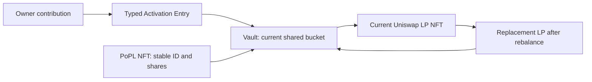

# Dynamic contributions, LP replacement and current NFT value

Fresh accounting4 supports [governance-triggered collective holder return](HOLDER_COLLECTIVE_EXIT.md).
After LP closes, each NFT retains unpaid proportional ETH+ZZZ principal, old
rewards and future royalty eligibility. Direct payouts are separate from income;
no holder principal withdrawal exists during normal operation. LP cannot reopen
after exit starts. Historical deployments keep their original rules.

This is the accounting and integration reference for the **undeployed candidate;
production NOT APPROVED**. Inputs are native ETH or the fixed deployment ZZZ.
It does not qualify live feeds, routes, a keeper schedule or production funds.
Remaining work belongs to the [central Todo](../TODO.md#task-security-share-accounting).

[Execution-loss policy](EXECUTION_LOSS_POLICY.md) defaults to 2% contribution,
1% conversion and 3% maintenance; direct governance may configure each up to 10%.
Stronger venue/caller minima and captured operation policy remain binding.
The separate [execution-quality floor](EXECUTION_QUALITY.md) limits additional
oracle-relative loss after actual directional core trading fees, default 1%.
Known fees still count toward gross and aggregate limits. Network gas is separate.
Historical fixed-limit profiles keep their own meaning.

## One shared LP, independent NFT accounts

`nftBucket` and `sharesOf` connect each PoPL NFT to a shared bucket. The bucket's
`Position.lpTokenId` identifies its **current** physical Uniswap position. It can
change on rebalance without changing the PoPL NFT ID, its owner or its share count.
One shared pool does not require 1,000 independent rebalances.

| Operation | Actual source path | Accounting consequence |
| --- | --- | --- |
| Activate/top up | [Entry](../src/ZZZActivationEntry.sol), [Vault `_join`](../src/ZZZVault.sol), [budget `contributionResult`](../src/ZZZMigrationBudget.sol) | Original source value, current incumbent NAV and measured marginal LP determine entry; minimum $100 gross activation/$5 growth and the captured marginal-deployed floor (98% at current default), gas separate. |
| Select token mix and swap venue | [Manager `balance`](../src/ZZZLiquidityManager.sol), [LPBalancer `plan`](../src/ZZZLPBalancer.sol) | Actual-core revert quotes compare bounded reviewed venues against current physical ticks; initial positions use Strategy `target`. Zero or one actual swap balances only the supplied budget. |
| Replace LP | [Vault `rebalance`](../src/ZZZVault.sol) | Harvest, release designated compound, close, balance and mint atomically; update current physical LP ID. Share counts persist. |
| Read current value | [LiquidityManager `amounts`](../src/ZZZLiquidityManager.sol), [Metadata `currentValue`](../src/ZZZNFTMetadata.sol) | Current position liquidity/ticks/spot determine token amounts; fresh, deviation-checked oracle prices mark those actual amounts. |
| Fund and claim | [Fees](../src/ZZZFeeController.sol), [LP rewards](../src/ZZZRewards.sol), [royalties](../src/ZZZRoyaltyRewards.sol) | Actual receipts back separate ledgers. Ownership transfer carries accrued unclaimed rights with the NFT. |
| Retire LP and return principal | [Collective holder return](HOLDER_COLLECTIVE_EXIT.md), [Migration](../src/ZZZMigration.sol) | Governance alone starts retirement and closes buckets; bounded allocation/direct-payout calls then return actual ETH/ZZZ by frozen shares to current owners. Normal holders need no action. Earned fees/royalties stay separate; rejected recipients retain retry/exceptional owner fallback. |

`Strategy.swapPlan` and `compoundPlan` remain callable calculation views; the
Vault no longer uses them to execute balancing. The Manager-created Balancer
simulates only admitted static, hookless ETH/fixed-ZZZ venues, after funds are
pulled and, for replacement, after the old LP has closed. It compares deployable
target LP value under one independent price vector, not raw liquidity units.
This bounded search is not a global best-price or minimum-gas guarantee. An empty
venue catalog disables swaps; it does not silently fall back to the LP pool.

Activation and growth balance/deploy the entrant's budget only. Existing idle
and released compound remain in incumbent NAV for later guarded maintenance;
they cannot subsidize the measured marginal LP added. Actual output, spot,
receipts, physical position and captured policy must pass before shares or
artwork change. See [atomic execution policy](LP_EXECUTION_POLICY.md).

## Contributions at a changed price

For raw token1/token0 square-root price `p`, lower/upper roots `a,b` and liquidity
`L`, in-range amounts are `amount0 = L(1/p - 1/b)` and `amount1 = L(p - a)`, with
the appropriate Q96 and token-decimal scaling. Below the range only token0 is
needed; above it only token1. These are token quantities, not equal USD weights.
Uniswap's [concentrated liquidity reference](https://developers.uniswap.org/docs/get-started/concepts/liquidity-providers/concentrated-liquidity)
explains range inactivity and the same core behavior in v3/v4.

A historical $0.50-$1.50 ZZZ/USDC arithmetic example is not a current input/pool
policy or a 50/50 value allocation at $1. At $1.40 it is heavily weighted toward
USDC. Real tick spacing rounds boundaries outward, so the rounded LP can still be in range at the nominal $1.50 example.
The [independent Decimal vectors](../reports/dynamic-liquidity/range-vectors.json)
cover nine prices, four decimal/order arrangements, $100/$10,000 inputs and
single/proportional dual-token plans. Those saved arithmetic/fixture results do
not qualify the selected hookless native-ETH/ZZZ venue, its swap/protocol fees,
actual depth or current execution. No Pons hook or creator funding is required.

For a bucket with existing shares `S`, incumbent value `V` and net new value `N`,
new shares are `floor(S * N / V)`. Initial shares equal net contributed USD units.
`V` is remeasured **after** the entry swap reprices incumbent LP and includes its
pre-existing idle/designated compound. Entry-swap fees, existing receipts and
compound settle under old weights before new shares/membership are added.
Unsolicited raw Vault prefunds are not attributed principal or income and cannot
subsidize the entry; claimable rewards and buyback reserves remain separate.
An actual Uniswap `PoolManager.donate` is different: it funds position fee growth.
When harvested, those funded fees follow the same 80/10/5/5 allocation under the
pre-entry shares and eligible membership. Their compound allocation belongs to
the incumbent NAV before new shares are issued. Funded fees are not proof of
organic trading volume or a sustainable return.
Floor rounding issues less than one raw share below the ideal rational result;
the economic value of that raw share depends on current NAV/share scale.

Share quantities survive rebalance; percentage ownership changes when new shares
are fairly issued. Repricing of incumbents is retained by incumbents, not awarded
to an entrant. This prevents accounting dilution, but it does not promise freedom
from swap impact, market losses, MEV, dishonest feeds or admitted venue failures.

## Admission and rebalance timing

The user chose to allow new activations/top-ups outside the current range, with
an explicit warning and all ordinary custody, oracle, route and captured contribution-floor checks retained.
An outside-range or operator-requested rebalance alone does not block a contribution. There is
no deposit queue, automatic user-triggered rebalance or arbitrary near-edge band.
If costs cannot meet the captured floor (98% at the current 2% default), the atomic transaction still reverts.

The quote's `liquidity_context` uses the same confirmed hash as its prices and
simulation. It reads the current physical LP ticks, StateView `slot0.tick`,
strategy eligibility and last-rebalance checkpoint. The read verifies canonical
slot0 integers, initialized TickMath bounds, coherent square-root price/tick,
valid directional protocol fees and the reviewed static LP fee. The exact check
is `sqrtAtTick(tick) <= sqrtPriceX96 <= sqrtAtTick(tick + 1)`, using integer v4
TickMath endpoints. Its inclusive upper endpoint admits the genuine stored tick
one below the boundary after a downward crossing. Range activity still uses the
original stored tick with `lower <= tick < upper`; replacing it with a calculated
floor tick would misclassify that boundary. These checks reuse the existing
pinned slot0 response, without another RPC read or response-schema change.

| Warning state | Meaning shown to the holder |
| --- | --- |
| Cooldown | Earliest eligibility is `lastRebalance + minRebalanceInterval`, shown as a UTC timestamp. Policy2 physical range exit or a pending approved range update and execution checks must still pass. |
| Eligible candidate | Raw cooldown and range-exit/manual-width conditions pass at the confirmed snapshot. Ordinary execution additionally requires confirmation1 readiness, keeper timing and all execution checks; this is not a guaranteed submission time. |
| Waiting for range exit | Cooldown has ended, the actual stored tick remains inside the physical range and no approved range mismatch exists; there is no scheduled rebalance. |
| Keeper timing unavailable | `next_keeper_check_at` and `expected_execution_at` are null. Never fabricate a countdown from the 600-second example polling setting. |

A wide range and frequent polling reduce the chance/time out of range; they do
not bound price jumps, cooldowns, pending confirmations, queueing, RPC/oracle
outages, budget limits or an offline keeper. The keeper discovers current buckets
and evaluates current state rather than replaying missed maintenance. See
the [recovery runbook](KEEPER_RECOVERY.md). A reliable next-check estimate needs
fresh authenticated operating telemetry, with stale/offline states explicitly
displayed. Even then it is a check estimate, not a guaranteed transaction time.

The selected [hookless native ETH/ZZZ pool](POOL_SELECTION.md) earns conventional
LP fees when its position is active. Out-of-range liquidity earns no conventional
swap fees until price returns or guarded maintenance changes its range. Funded
claims and activation/royalty eligibility survive. This does not promise continuous
fee income or external creator payments. Policy2 initially imposes a hard
12-hour minimum; early range exit does not bypass it. The fresh confirmation1
keeper profile checks eligible inside/outside positions every four minutes.
Historical policy2 profiles without that capability retain their hourly checks.
Durable 1-10-minute jitter and current execution guards still apply independently.

Fresh Strategy creates [RebalanceConfirmation](../src/ZZZRebalanceConfirmation.sol).
Its ordinary range-exit window defaults to15minutes, measured by receipt-backed
on-chain observations on the same side of the same physical LP. A maximum gap
must be explicitly configured by governance; source default0 blocks ordinary
rebalance, not the safeguard. The selected operating configuration is900seconds
with a strict300second maximum gap: any greater gap restarts confirmation. A
four-minute source schedule leaves roughly60seconds for work/inclusion delay;
longer delays can still restart. The on-chain300-second gap gains no grace.
Gaps, observed range re-entry, opposite-side exit,
LP/configuration changes and successfully recorded faults invalidate old evidence.
Normal healthy feed rounds do not reset it. The existing deliberate width-change
exception still requires raw cooldown/price eligibility, but bypasses this timer.

`needsRebalance` remains raw candidacy so compound yields while confirmation is
pending; Budget instead requires `rebalanceReady` for actual replacement. A fresh
read fault fails closed. An observed failure clears evidence only when an
`observe` or clear-only `resetObservation` transaction succeeds; a failed send
cannot clear on-chain state. The operator/worker must reconcile its receipt.
Samples and jitter cannot prove that price stayed outside between checks or
prevent sustained manipulation. No live service, public transaction or chosen
operating-policy application is implied by this source implementation. Budget
also captures stable registry, Oracle-policy, quality and confirmation controls
and the bucket's raw observation tuple before closing, then compares them after
deployment. A callback reset cannot erase the evidence and still complete the
buffered rebalance; failure rolls the complete operation back. This comparison
uses recorded evidence rather than asking whether the newly replaced LP is
already eligible, which would incorrectly reject every successful replacement.
Changed-and-restored governed controls also invalidate the captured operation.

## Changing the range after sealing

The current governance wallet directly calls the Registry/Strategy setters,
authenticated through Access; there is no scheduler or forwarding executor.
`rangeBps` is an approximate half-width before outward tick rounding: 1,000 means
+/-10% in the explicitly configured orientation. Mode0 is raw token1/token0;
mode1 is token0/token1 (ZZZ priced in ETH for the selected native pair). These
inverse ratios have different numeric endpoints; do not infer orientation from
the ticker alone. The registry permits 100-5,000 basis points; trigger and spot-deviation settings must remain inside their own bounds
and below the half-width. These are parameter changes, not code upgrades.

Updating this setting does not instantly resize the current physical LP. The
implemented [range-policy path](RANGE_POLICY_UPDATES.md) compares deployed ticks
with the configured target at the recorded LP center. A mismatch can satisfy
the existing rebalance trigger even at a flat price, after the normal cooldown.
The keeper uses ordinary rebalance with all price, minimum-output, captured
governed maintenance-budget and idle guards retained. Successful replacement clears the mismatch. No new force-rebalance authority is added; governed parking remains a separate recovery
process. Production strategy qualification remains in the central Todo.

The separate opt-in automatic-selection source capability is limited to
governance-approved +/-25% and +/-50%
presets in ZZZ-price-in-ETH orientation. The on-chain rule chooses the width from
reviewed displacement thresholds and cadence; the keeper supplies no arbitrary
width. It is not the manual-width policy2 keeper's enabled scheduling mode.
Selection only updates desired configuration; a separately confirmed
guarded rebalance applies physical ticks. Cooldown, pending-tick mismatch and
configuration fingerprints still constrain it. See [range operations](RANGE_POLICY_UPDATES.md).

### Standalone compounding gives range maintenance priority

Fresh maintenance policy2 Budget capability3 permits a standalone compound only after
`max(lastCompound, lastRebalance) + compoundInterval(poolId)`, including
after LP creation and for jobs with no swap. It also waits if a rebalance is
eligible or the preapproved adaptive-range rule already has a nonzero target.
`Budget.compoundReady(bucket)` reports that decision; authorization, lifecycle,
prices, simulation and execution limits remain independent requirements.

The priority is one-way: rebalancing keeps its existing `lastRebalance` clock,
so compounding cannot postpone it. Hourly standalone harvesting, funded claims
and guarded user contributions remain independent. A contribution can release
old designated compound into incumbent idle, but may not swap or deploy it;
guarded compounding can use it later, including without new fees. Historical
accounting1/2/3 keeps capability1 semantics. Fresh keeper jobs must pin and verify
Budget capability3 before trusting `compoundReady`, even for reserve-only work.
Explicit historical accounting4/helper2 retains its old shared interval. New compound
interval defaults3600seconds and is governed600seconds-7days independently of
rebalance. Policy2 rebalance uses actual physical range exit or an operator width
change after the configured hard minimum. [Scope](../reports/maintenance-policy-20261027/VERIFICATION.md).
An eligible adaptive policy with its local range job disabled can defer compound;
review the policy/job instead of forcing reinvestment past it.

## Aggregate rebalance budget

The Budget snapshots the current `maintenanceLossBps()` as `L` (default 300,
hard maximum 1,000), principal and attributed idle at fresh initial prices
**before harvest**. It adds exact released compound, closes/balances/mints and
requires final LP plus idle to retain at least
`startingValue - floor(startingValue * L / 10000)` at that same initial
price/decimal vector. The 5% idle ceiling and every per-step guard remain.
New fee receipts, claim balances, buyback funds and donations cannot cover a
deficit. Failure rolls back the operation, including its harvesting; gas is spent.
A callback or later policy edit cannot weaken the captured operation.

This reuses the same checkpoints as same-ordered-pair moves/resumes; the existing
`MigrationValueChecked` event also records successful ordinary rebalances.
At default L=300 it is a 97% **LP plus idle** floor, not a 97%-deployed promise,
a target loss, an impermanent-loss hedge or protection against repeated cumulative erosion.
It does not qualify a malicious venue that lies about retained amounts, dishonest
starting oracle prices or unsupported different-pair conversion. No external
custodian, issuer-exchange or bridge path remains. Collective raw ETH/ZZZ return
is a terminal operation with reviewed raw minima, not another rebalance budget.

## Current value, metadata and frontend

For each NFT: `floor(bucket NAV * NFT shares / bucket total shares)`. NAV includes
current deployed token amounts, attributed idle and designated compound reserves.
It excludes claimable LP fees, royalties, buyback reserves and unallocated gifts.
The `contributionUSD` counter is historical gross input, never current LP value.
Current value is an oracle mark, not an executable redemption quote: holders
cannot redeem principal during normal operation. Collective retirement instead
apportions actual closed ETH/ZZZ; it does not promise historical USD or token quantities.

The price guard also applies to metadata; a pool spot outside its admitted oracle
deviation produces unavailable value. Honest marks remain readable when pool
operations are disabled. Parked custody and dependency failures
stay unavailable, not zero or an invented historical price. Activation and its
royalty weight persist through falling value and unavailable valuation.

Fresh accounting4/custody3 uses canonical
`ZZZ_CANONICAL_SAME_CHAIN_HOLDER_EXIT_V5`. After a bucket closes for holder return,
Exited5 reports confirmed zero LP and terminal `lp_exited`/`LP exited`, while
retaining royalty eligibility. Pending5%compound joins returned principal;
earned LP/royalties, buyback reserves and unrelated funds do not. Principal
allocations/payouts are never added to earnings or reward claim totals. All new
mint/LP work and canonical replacement remain blocked once exit starts, even
after ordinary unpause. Historical readers/journals keep their original profiles.
Permissionless delivery calls cannot initiate exit or choose another beneficiary.
The operator may submit batches or enable the reviewed optional keeper
`principal_distribution` job. It uses the existing budgeted transaction/recovery
path, allocates only after governance closes all buckets, and directly pays
current owners without holder action. Source implementation is disabled by
default; no actual service or production operating qualification is implied.

`tokenURI` dynamically selects the artwork stage from current value. Market
movement does not itself emit an event. The existing bounded ordinal refresh
(maximum 50) and optional keeper stage/availability watcher notify caches; they
do not update every dollar change or guarantee external marketplace refresh.

The read API must resolve the current group and its share denominator at each
confirmed snapshot. Consumers must discard cached physical IDs/ranges after
replacement, and must reprepare before signing if the position/range changes.
The Entry calldata has economic minima and a deadline, not a physical-LP version
lock: a previously signed transaction can execute after rebalance if all current
contract safeguards still pass. Do not claim an on-chain stale-position veto.

The separate popldemo website remains a labelled simulation with example amounts,
Number-based demo IDs and no live dependency on this API. Served poplint uses
the [unconfigured current3 profile](CURRENT_WEBSITE_PROFILE.md), not fresh4.
Fresh4 live integration must
use decimal-string IDs/amounts, canonical block provenance, current marked NAV,
separate LP/royalty claim balances, full lifetime claims and unavailable states.
An indexer `Rebalanced` event invalidates cached position identity; events alone
cannot establish a fresh USD value. No frontend/server deployment is included.

Evidence, fixed defects and remaining risks are recorded in the
[scoped review](../reports/dynamic-liquidity/REVIEW.md). Release remains **NOT APPROVED**.
