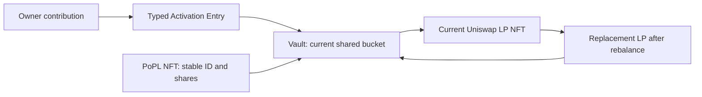

# Dynamic contributions, LP replacement and current NFT value

This is the accounting and integration reference for the development candidate.
It does not qualify live feeds, routes, a keeper schedule or production funds.
Remaining work belongs to the [central Todo](../TODO.md#task-security-share-accounting).

## One shared LP, independent NFT accounts

`nftBucket` and `sharesOf` connect each PoPL NFT to a shared bucket. The bucket's
`Position.lpTokenId` identifies its **current** physical Uniswap position. It can
change on rebalance without changing the PoPL NFT ID, its owner or its share count.
One shared pool does not require 1,000 independent rebalances.

| Operation | Actual source path | Accounting consequence |
| --- | --- | --- |
| Activate/top up | [Entry](../src/ZZZActivationEntry.sol), [Vault `_join`](../src/ZZZVault.sol), [budget `contributionResult`](../src/ZZZMigrationBudget.sol) | Original source value, current incumbent NAV and measured marginal LP determine entry; minimum $100 gross for activation and at least 99% marginal deployed value, gas separate. |
| Select token mix | [Strategy `compoundPlan` / `_plan`](../src/ZZZStrategy.sol) | Existing contributions use the actual current LP ticks. Initial positions use `target` at current oracle prices. |
| Replace LP | [Vault `rebalance`](../src/ZZZVault.sol) | Harvest, release designated compound, close, balance and mint atomically; update current physical LP ID. Share counts persist. |
| Read current value | [LiquidityManager `amounts`](../src/ZZZLiquidityManager.sol), [Metadata `currentValue`](../src/ZZZNFTMetadata.sol) | Current position liquidity/ticks/spot determine token amounts; fresh, deviation-checked oracle prices mark those actual amounts. |
| Fund and claim | [Fees](../src/ZZZFeeController.sol), [LP rewards](../src/ZZZRewards.sol), [royalties](../src/ZZZRoyaltyRewards.sol) | Actual receipts back separate ledgers. Ownership transfer carries accrued unclaimed rights with the NFT. |

## Contributions at a changed price

For raw token1/token0 square-root price `p`, lower/upper roots `a,b` and liquidity
`L`, in-range amounts are `amount0 = L(1/p - 1/b)` and `amount1 = L(p - a)`, with
the appropriate Q96 and token-decimal scaling. Below the range only token0 is
needed; above it only token1. These are token quantities, not equal USD weights.
Uniswap's [concentrated liquidity reference](https://developers.uniswap.org/docs/get-started/concepts/liquidity-providers/concentrated-liquidity)
explains range inactivity and the same core behavior in v3/v4.

A $0.50-$1.50 illustrative ZZZ/USDC range is not a 50/50 value allocation at $1.
At $1.40 it is heavily weighted toward USDC. Real tick spacing rounds boundaries
outward, so the rounded LP can still be in range at the nominal $1.50 example.
The [independent Decimal vectors](../reports/dynamic-liquidity/range-vectors.json)
cover nine prices, four decimal/order arrangements, $100/$10,000 inputs and
single/proportional dual-token plans. They do not substitute for actual Pons
execution. Production's native-ETH/ZZZ pair and hook costs remain distinct.

For a bucket with existing shares `S`, incumbent value `V` and net new value `N`,
new shares are `floor(S * N / V)`. Initial shares equal net contributed USD units.
`V` is remeasured **after** the entry swap reprices incumbent LP and includes its
pre-existing idle/designated compound. Entry-swap fees, existing receipts and
compound settle under old weights before new shares/membership are added.
Donations, claimable rewards and buyback reserves cannot subsidize the entry.
Floor rounding issues less than one raw share below the ideal rational result;
the economic value of that raw share depends on current NAV/share scale.

Share quantities survive rebalance; percentage ownership changes when new shares
are fairly issued. Repricing of incumbents is retained by incumbents, not awarded
to an entrant. This prevents accounting dilution, but it does not promise freedom
from swap impact, market losses, MEV, dishonest feeds or admitted venue failures.

## Admission and rebalance timing

The user chose to allow new activations/top-ups outside the current range, with
an explicit warning and all ordinary custody, oracle, route and 1% checks retained.
A pending price-triggered rebalance alone does not block a contribution. There is
no deposit queue, automatic user-triggered rebalance or arbitrary near-edge band.
If costs cannot meet the 99% floor, the atomic transaction still reverts.

The quote's `liquidity_context` uses the same confirmed hash as its prices and
simulation. It reads the current physical LP ticks, StateView `slot0.tick`,
strategy eligibility and last-rebalance checkpoint. Range activity uses
`lower <= tick < upper`; at an exact downward crossing, sqrt price alone is not
enough to classify the active tick.

| Warning state | Meaning shown to the holder |
| --- | --- |
| Cooldown | Earliest eligibility is `lastRebalance + minRebalanceInterval`, shown as a UTC timestamp. The price trigger and execution checks must still pass. |
| Eligible now | Cooldown and price trigger pass at the confirmed snapshot. Execution awaits a keeper and successful safety checks. |
| Waiting for price trigger | Cooldown has ended; no scheduled execution time can be inferred. |
| Keeper timing unavailable | `next_keeper_check_at` and `expected_execution_at` are null. Never fabricate a countdown from the 600-second example polling setting. |

A wide range and frequent polling reduce the chance/time out of range; they do
not bound price jumps, cooldowns, pending confirmations, queueing, RPC/oracle
outages, budget limits or an offline keeper. The keeper discovers current buckets
and evaluates current state, not a backlog of missed 10-minute rebalances. See
the [recovery runbook](KEEPER_RECOVERY.md). A reliable next-check estimate needs
fresh authenticated operating telemetry, with stale/offline states explicitly
displayed. Even then it is a check estimate, not a guaranteed transaction time.

The selected Pons pool has zero conventional LP fees and separate externally
funded revenue. The warning describes inactive swap liquidity without promising
creator payments or revoking already funded claims/royalty eligibility.

## Aggregate rebalance budget

The user approved a fixed **3% aggregate execution-loss cap for ordinary
rebalances**, gas separate, on 2026-10-18. The existing helper snapshots principal
and attributed idle at fresh initial prices **before harvest**. It then adds
exact released compound, closes/balances/mints, and requires final LP plus idle
to retain at least `startingValue - floor(startingValue * 300 / 10000)` under that
same price/decimal vector. The 5% idle ceiling and every existing per-step guard
remain. New fee receipts, claim balances, buyback funds and donations cannot
cover a deficit. Failure rolls back the entire operation, including harvesting.

This reuses the same checkpoints as same-ordered-pair moves/resumes; the existing
`MigrationValueChecked` event also records successful ordinary rebalances.
It is a 97% **LP plus idle** floor, not a 97%-deployed promise, a target loss,
an impermanent-loss hedge or protection against repeated cumulative erosion.
It does not qualify a malicious venue that lies about retained amounts, dishonest
starting oracle prices, different-pair conversion or asynchronous bridging.

## Current value, metadata and frontend

For each NFT: `floor(bucket NAV * NFT shares / bucket total shares)`. NAV includes
current deployed token amounts, attributed idle and designated compound reserves.
It excludes claimable LP fees, royalties, buyback reserves and unallocated gifts.
The `contributionUSD` counter is historical gross input, never current LP value.
Current value is an oracle mark, not an executable redemption quote: holders
cannot redeem principal.

The price guard also applies to metadata; a pool spot outside its admitted oracle
deviation produces unavailable value. Honest marks remain readable when pool
operations are disabled. Remote/in-flight/parked custody and dependency failures
stay unavailable, not zero or an invented historical price. Activation and its
royalty weight persist through falling value and unavailable valuation.

`tokenURI` dynamically selects the artwork stage from current value. Market
movement does not itself emit an event. The existing bounded ordinal refresh
(maximum 50) and optional keeper stage/availability watcher notify caches; they
do not update every dollar change or guarantee external marketplace refresh.

The read API must resolve the current group and its share denominator at each
confirmed snapshot. Consumers must discard cached physical IDs/ranges after
replacement, and must reprepare before signing if the position/range changes.
The Entry calldata has economic minima and a deadline, not a physical-LP version
lock: a previously signed transaction can execute after rebalance if all current
contract safeguards still pass. Do not claim an on-chain stale-position veto.

The separate website remains a labelled simulation with example amounts,
Number-based demo IDs and no live dependency on this API. Live integration must
use decimal-string IDs/amounts, canonical block provenance, current marked NAV,
separate LP/royalty claim balances, full lifetime claims and unavailable states.
An indexer `Rebalanced` event invalidates cached position identity; events alone
cannot establish a fresh USD value. No frontend/server deployment is included.

Evidence, fixed defects and remaining risks are recorded in the
[scoped review](../reports/dynamic-liquidity/REVIEW.md). Release remains **NOT APPROVED**.
