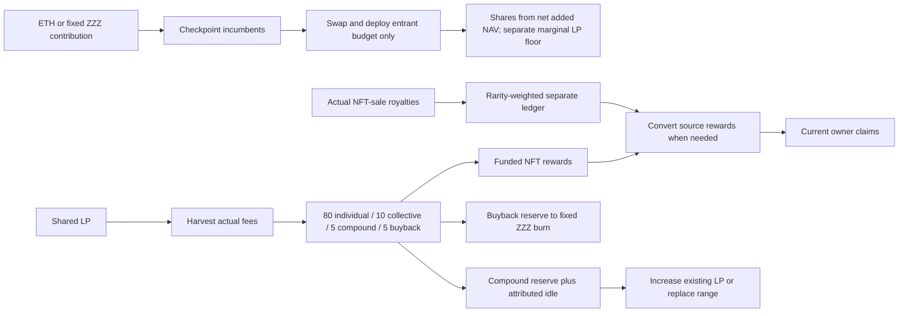

# Normal operation: whole-system reassessment

Read-only design review of main `ba5aa0bad0755a7179127a53ade0c7608842fb1f`,
2026-10-29. No financial/contract/keeper/API behavior, settings, services,
transactions or journals changed. This report corrects and expands the earlier
four-point simplification recommendation. It is not an implemented planner,
timer change, new test campaign or production approval.

The earlier framing was too narrow: a late rebalance can be an intentional
cooldown, missing price/route qualification, scheduling failure, a reserve trigger
that is disabled, a lifecycle lock, or a genuinely uneconomic transaction.
These require different remedies. Fewer checks alone cannot resolve them.

## 1. The complete operating model

At launch many NFTs share one physical ETH/ZZZ LP; there are not1,000separate
rebalances or harvests. Each NFT has independently accounted shares and rights.
Future custody history is bounded to four buckets, not four mandatory launch LPs.
One human controls governance and operates services, while the automated keeper
retains a limited key. User-wallet operations do not pass through its nonce lane.

| Operation | Budget and ownership | Coordination that must survive simplification |
| --- | --- | --- |
| Mint/reveal/transfer | Mint is dormant ownership; fixed draw/reveal is separate. Current owner inherits unclaimed rights. | OpenSea integration and VRF are actual dependencies, not solved by LP scheduling. Transfer/approval is not principal withdrawal. |
| Activate/grow | Only entrant ETH/ZZZ swaps/deploys; minimum$100/$5, governed cumulative cap, captured contribution policy and caller maximum. | Existing fee/dust/compound checkpoints precede share/eligibility changes. Incumbent repricing and idle cannot subsidize the entrant. Top-ups do not recenter LP or reset rebalance time. |
| Harvest | Whole20-unit receipts split16/2/1/1; carried/sub20 dust has incumbent settlement rules. Individual shares and equal activated collective differ; rarity does not multiply LP fees. | Hourly standalone collection is independent, but contributions/compound/rebalance also harvest internally. Repeated boundary harvests protect attribution; zero new receipts are not a second allocation. |
| LP rewards/royalties/claims | Two funded ledgers, existing fractions and current-owner rights; royalty currencies/cohorts are separate. | Collection, conversion, allocation and payout are different events. Faulted optional royalty currency does not imply failed activation. Preserve old cohorts and do not count conversions/claims as fresh income. |
| Compound/reinvest idle | Existing bucket's designated compound and attributed principal idle, without new NFT shares. | May increase the existing position and may swap. It is not equivalent to replacing the range or to an entrant's contribution. |
| Rebalance | Full attributed principal plus released compound closes, may swap through reviewed venues, and remints a range. | Preserve hard interval, sampled same-side reference confirmation, explicit width exception, route/quote/price/aggregate guards and callback rollback. |
| Buyback | Its own5% reserve; fixed ZZZ burn. | Not triggered by claims; task/route/threshold/gas configuration is separate. LP routing's best-venue selection does not automatically apply to every converter/buyback path. |
| Move/park/resume | Same-native-pair custody with existing shares, governed controls and raw minima. | Parking is reversible; terminal holder return is not. Neither is an external-custodian exit or token replacement. |
| Terminal exit/canonical handoff | Exit returns principal+compound to current owners, preserving rewards/future royalties. Pre-exit same-chain canonical replacement carries the whole ledger. | Keep these distinct state machines, exact backing and bounded recovery. No automatic emergency bypass, external sweep, post-exit reopening or canonical replacement. |

The current system distinguishes at least: NFT/reveal state; custody lifecycle;
principal NAV; total earned versus claimable/claimed; compound/buyback reserves;
royalty cohorts; market condition; execution feasibility; and transaction recovery.
A single green/red “LP ready” flag would conceal important states.

Shares are issued from net added NAV, including attributed new idle; actual
marginal deployed LP is a separate contribution acceptance floor. Likewise the
20-unit fee split is not exact for every tiny receipt: sub20 dust settled before
entry goes to incumbent individual rewards. Preserve the existing explicit dust
rules and its economic-qualification task rather than assuming every raw unit
reaches every percentage reserve immediately.

## 2. What the current normal clocks actually do

| Clock/state | Current meaning |
| --- | --- |
| Rebalance interval | `lastRebalance + minRebalanceInterval`, intended initial12hours. Hard minimum even outside; a deliberate width change also waits. |
| Sampled confirmation | Selected900seconds, strict300-second maximum recorded gap, source checks240seconds. Starts only after cooldown because condition calls `needsRebalance`. Physical/reference must be outside the same actual bounds on the same side. |
| Jitter | Persisted60-600seconds after sampled readiness, with continuing observations. It is modest scheduling unpredictability, not a price oracle or MEV guarantee. |
| Compound interval | `max(lastCompound,lastRebalance) + compoundInterval`, default1hour. Rebalance postpones next compound; compound does not postpone rebalance. |
| Harvest schedule | Standalone `harvest:bucket` receipt clock, default1hour in accounting4. Internal harvests currently do not advance this local key. |
| Conversion/buyback/metadata/delivery | Separate thresholds, retry policies, durable queue fairness and gas/spend budgets. Backing or eligibility alone does not schedule execution. |
| Pending recovery | Shared service nonce lane reconciles saved work first. No new action should hide or overwrite it. |

Thus12hours is not a promise to rebalance at12hours. Current sequential cooldown,
confirmation and jitter add delay. A sustained verified exit before cooldown is
not recorded today. Source checks are not confirmed sample timestamps, and one
current price cannot prove four hours of previous history.

**Correction to the earlier recommendation:** deadline-first renewal/reset work
and isolation from unrelated optional backoff are already implemented in
[the last audit](../whole-project-execution-20261029/KEEPER.md). They remain
unqualified on actual operating infrastructure; they should not be sold again
as a new source feature. Pending recovery/shared gates still take precedence.

## 3. Normal interactions missed by the earlier plan

1. **Compounding changes behavior at cooldown expiry.** Before12hours,
   `needsRebalance` is false by time, so a one-hour-eligible compound can swap into
   the old range even if it is outside. Execution/price guards still apply. After
   cooldown, physical exit makes raw need true and blocks all standalone compound,
   including no-swap work, even when reference disagreement blocks replacement.
   This is not accurately described as simply “compound yields to rebalance.”
   These need checks require enabled pool operations and valid price/spot reads;
   otherwise the result may be unavailable or disabled, not raw need=true.
2. **Idle scheduling differs from on-chain ability.** Contributions move old
   compound into incumbent idle/NAV while deploying only entrant budgets.
   `compound_idle:false` can leave useful idle unscheduled when new fee reserves
   are zero. Contract support for reinvestment is not a configured worker trigger.
   The fresh example intentionally remains blocked/unqualified; do not silently
   enable its job or invent deployed thresholds.
3. **Idle can also affect incoming users.** All attributed idle remains owned and
   included in NAV, but the whole-bucket5%idle ceiling can reject otherwise valid
   new contributions. Disabling reinvestment without an explicit recovery policy
   can therefore affect activation/growth, not just compounding yield.
4. **Standalone harvest may be redundant after maintenance.** Compound/rebalance
   already harvested but leave the standalone local clock unchanged. A fee-only
   transaction may follow soon afterward. Coalescing is a reasonable option, not
   an existing feature: require actual successful canonical receipts and matching
   Vault/bucket `FeesCollected` evidence, atomically recorded. Never advance on
   submission/revert/ambiguity. External user contributions need a separately
   authenticated observed fee clock; their activity cannot be guessed from NAV.
5. **A blocked principal operation need not block all other work.** Healthy
   funded claims, independently guarded harvesting, conversions and royalty
   registration have their own permissions/dependencies. Global pause, pool
   disablement, preparation, parking and terminal exit are different restrictions.
   There is no universal “everything is paused/unavailable” conclusion.
6. **Route/reference/claim currency are different problems.** An admitted best
   LP-balancing venue is not automatically a converter route; positive ZZZ reward
   entitlement is not immediately available ETH. The selected pool's known fee
   can exceed a1%conversion budget even with negligible additional impact.
   Independent reference currently means configured dual USD sources, not a
   qualified dynamically selected highest-liquidity pool or TWAP adapter.
7. **One nonce/spending lane is a resource constraint.** Even with one launch LP,
   harvest/converters/observations/metadata/buyback compete for service resources.
   Bounded future custody history adds windows. Gas caps, pending transactions,
   RPC latency and confirmed inclusion can still restart a strict300-second
   window. Do not solve that by quietly weakening it or authorizing parallel
   unjournaled signers.
8. **UI state must describe the actual operation.** A claim does not imply an
   artwork update; a confirmed contribution waits for actual added LP before
   evolving its NFT. Missing prices need not erase verified ownership/ETH
   balances. Public signing remains disabled and current4 integration remains
   a separate task; a unified report grants neither authority nor a deployment.

## 4. Assess the overlapping financial check precisely

The pre-mint whole-idle-budget check is `Budget.assertIdleLoss` in Vault
`_redeploy`. Activation/growth use a separate entrant path and actual marginal
LP guards; contribution2% is not this pool's slippage setting. The fresh
production example's `maxSlippageBps` is unconfigured, not an approved2%default.

For ordinary zero/one-swap balancing, fixed marks and ignoring integer rounding,
let B be the lower-USD whole idle budget, I<=B the lower-USD swapped input,
U>=I its upper-USD mark, t the target fractional allowance, v the venue allowance
and s=min(t,v). O is lower-USD actual output. Exact swap guards imply
O >= (1-s)U >= (1-s)I, hence retained B-I+O >= B-sI >= (1-t)B.
Under these conditions the whole-budget cap overlaps the per-swap floor.

That is a conditional argument, not a removal proof. Raw rounding, fresh
valuation timing, source policy versus ordinary round updates, and emergency
retained-check combinations matter. Emergency routing can retain the whole
budget cap while bypassing the ordinary helper's tighter-target comparison;
blanket deletion would remove an independently binding financial protection.
The final3%aggregate check also measures a different full-bucket denominator.

The useful next assessment is a shared valuation/explanation model, then a
source-exact rounding/control proof for any proposed normal-path consolidation.
Do not justify deletion with a counterexample that assumes surviving swap floors
are absent, and do not remove custody/settlement/callback/ownership/reserve checks.

## 5. Revised improvement sequence and explicit choices

**First: define one operation report, not another financial control.** Reuse
existing typed readers and exact formulas at one block/profile/action identity.
Show principal/reserve/claim domains, raw condition, cooldown, sampled readiness,
worker schedule, route/price checks, fee-aware and all-in floors, gas, simulation
scope and recovery. Distinguish `not_needed`, `not_due`, `blocked`, `unavailable`,
`not_configured` and `unsupported`. A stale health record is not the present
blocker. Generic400/503 or `Slippage()` does not identify every exact failed
inequality: expose verified typed reasons where available, otherwise admit that
the failing condition is unclassified. Never echo raw provider strings as truth.

**Then reconcile routine work.** Assess receipt-backed harvest coalescing and
explicit economic idle/reserve triggers. Preserve required attribution harvests
inside contributions/maintenance. Measure costs and do not chase negligible dust.

**Then decide confirmation enrollment.** Options are current post-cooldown
sampling; sampling only during the final configured confirmation duration before
cooldown; an explicit earlier margin; or full-cooldown sampling. The near-expiry
window is the most economical candidate, but needs separation of market evidence
from execution eligibility, a precise start/reset rule and paid-observation cost
qualification. Keep hard12hours, same-side actual bounds,900/300 and post-ready
jitter. Jitter starts only after both hard cooldown eligibility and sampled
proof readiness, never early enough to expire during cooldown. Cold starts/missed
gaps still need fresh evidence; no inferred history.

**Decide compounding by its actual action.** Keeping current policy preserves the
before/after-cooldown asymmetry. Deferring all outside-range compound prevents
outside-range balancing swaps but can worsen idle accumulation and entry availability. A
separate on-chain no-swap increase path could permit safe useful reinvestment
without bypassing blocked replacement; it adds code/profile/verification cost
and cannot recover the wrong-side token without a swap. An off-chain prediction
alone cannot guarantee that execution makes no swap. This remains an economic/
architectural choice, not a selected new feature.

**Only then consolidate financial checks if proven safe.** Specify marks,
denominators, timing, rounding, source revisions and emergency applicability.
The Manager's37-byte initcode margin is real: additions need normal build gates;
a design report is not proof of fitting code. No cap or emergency authority is
automatically widened to make an unavailable operation proceed.

## Scope and evidence

The three independent source assessments and their before-edit hashes are retained
externally in `normal-maintenance-design-20261029`. [Source pins](source-pins.json)
identify the contract/keeper/API/config paths reviewed. No tests or live probes
were run because this step changes no implementation. Documentation/Todo/link
consistency is checked separately. The sole Todo owns future task status.
Historical services and source reports retain their original profiles/evidence.

Primary source anchors: [Vault entry/harvest/compound/rebalance](../../src/ZZZVault.sol),
[Strategy raw need](../../src/ZZZStrategy.sol),
[confirmation helper](../../src/ZZZRebalanceConfirmation.sol),
[compound decision and valuation](../../src/ZZZContributionPricing.sol),
[budget guards](../../src/ZZZMigrationBudget.sol),
[worker](../../keeper/monitor.py),
[current idle policy](../../docs/IDLE_AND_DUST.md),
[API preparation](../../frontend_api/activation.py) and
[public failure mapping](../../frontend_api/activation_server.py).
